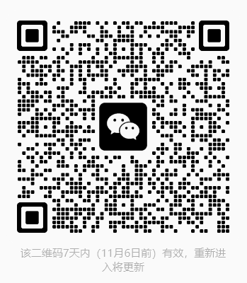

# outsourcing-people
外包人员 维权信息分享

### 初心
之前市面上看到有APP 提供公司差评信息查询的软件，但之后因为各种各样的原因，最后都被下架了，故站在今天社会主义之下，深刻研读红色文章之后决定建立仓库在我们的 hub 之上，存留历史信息。

**可分享违法加班、劝退、背绩效C、 解除合同、人身侮辱、违法待岗 等等等..........**

也可以加微信群分享信息（只有7 天有效期，有时候我会更新，有时候偷懒，可以直接私信dy【Life_fuc._movie】我发二维码）：

### 用法

大家随便提交 md 文档或者txt 文档叙事，记录从前到后争取劳动者合法权益的艰难漫长过程，fork 项目之后创建分支提交pull request，我再统一合并到main 分支里面来。

或者大家不太会用git 的话， 可以抖音抖索抖音号 【Life_fuc._movie】 之后直接私信发送给我，我来上传大家的故事。

**上传信息的时候不要包含自己的真实姓名信息，避免劳动阶级的叛徒别有用心。**

### 后期彩蛋

最近因为失业了，休息的时间中无聊，研究AI漫剧生成，可以交流分享的可以直接和抖音【Life_fuc._movie】，我们一起交流学习；言归正传，我准备把我的离职维权故事，以及大家的好的故事，做成AI漫剧，所以大家允许的情况下可以提交故事的时候留下自己的抖音号，到时候做出来@你们，哈哈哈哈哈，就是觉得有趣，合法权益的获取都这么漫长艰辛。

